<div align="center">


<br />

[](https://www.python.org/)
[](https://pyga.me/)
[](https://numpy.org/)
[](https://opencv.org/)
[](https://ai.google.dev/edge/mediapipe/solutions/vision/hand_landmarker)
[](#-como-rodar)

[](docs/enunciado_AP2.pdf)
[](#-equipe)
[](#-destaques)
[](#-gesto-do-arco-duas-câmeras)
[](#-câmeras-detecção-e-problemas-comuns)
[](#-requisitos-do-enunciado)
[](https://github.com/gblsun/Arrow-the-target/commits/main)
[](https://github.com/gblsun/Arrow-the-target)

<br />

**[🎬 Vídeo](#-vídeo-de-apresentação)** &nbsp;·&nbsp;
**[✨ Destaques](#-destaques)** &nbsp;·&nbsp;
**[🧠 Mapa mental](#-mapa-mental)** &nbsp;·&nbsp;
**[🚀 Como rodar](#-como-rodar)** &nbsp;·&nbsp;
**[🎮 Como jogar](#-como-jogar)** &nbsp;·&nbsp;
**[🏹 Gesto do arco](#-gesto-do-arco-duas-câmeras)** &nbsp;·&nbsp;
**[👥 Equipe](#-equipe)** &nbsp;·&nbsp;
**[📚 Documentação](docs/DOCUMENTACAO.md)**

<br />

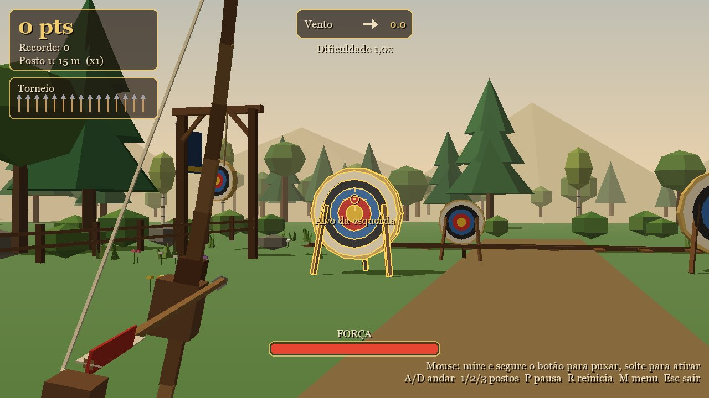

</div>

<br />

> **Torneio de tiro com arco numa clareira da floresta.** A mira é feita com as mãos por duas webcams (frontal e lateral), imitando um arco: a mão esquerda segura o arco e a direita puxa a corda e solta a flecha. A cena 3D é renderizada "na mão" com pygame e matrizes numpy (sem OpenGL), como nos exemplos de `ref/exercicios/pygame_aulas_1_a_9`.

AP2 de Computação Gráfica RA/RV (CC6AM, 2026.2). Documentação técnica (arquitetura, pipeline gráfico, gestos, calibração, câmeras, parâmetros e requisitos): [docs/DOCUMENTACAO.md](docs/DOCUMENTACAO.md).

<details>
<summary><b>📑 Sumário</b></summary>

- [🎬 Vídeo de apresentação](#-vídeo-de-apresentação)
- [✨ Destaques](#-destaques)
- [🧠 Mapa mental](#-mapa-mental)
- [👥 Equipe](#-equipe)
- [🚀 Como rodar](#-como-rodar)
- [🎮 Como jogar](#-como-jogar)
  - [🏹 Gesto do arco (duas câmeras)](#-gesto-do-arco-duas-câmeras)
  - [🎯 Calibração guiada](#-calibração-guiada)
  - [⌨️ Teclado e mouse](#️-teclado-e-mouse)
- [📷 Câmeras: detecção e problemas comuns](#-câmeras-detecção-e-problemas-comuns)
- [⚡ Desempenho](#-desempenho)
- [✅ Requisitos do enunciado](#-requisitos-do-enunciado)
- [🗂️ Estrutura](#️-estrutura)

</details>

---

## 🎬 Vídeo de apresentação

O vídeo mostra o jogo sendo jogado com as mãos: a calibração das mãos e do arco e os tiros nas três distâncias (postos de 15, 25 e 40 m).

<div align="center">

[](docs/video/video-apresentacao.mp4)

[-8B5A2B?style=for-the-badge)](docs/video/video-apresentacao.mp4)
[](https://youtu.be/HdlcKxR3SQQ)

</div>

| Calibração do arco | Jogando com o gesto | Tiro de longe |
|:---:|:---:|:---:|
| 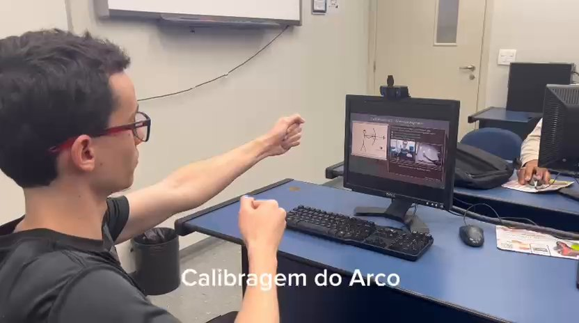 | 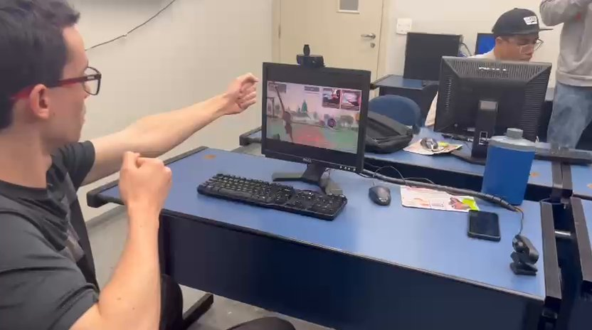 | 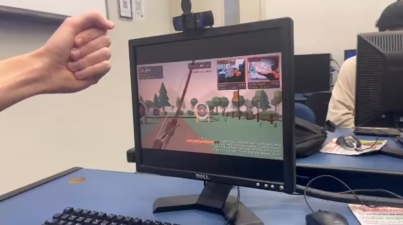 |

---

## ✨ Destaques

<table>
<tr>
<td width="50%" valign="top">

### 🏹 Arco de verdade, com as mãos
Duas webcams e o MediaPipe Hands: a mão esquerda mira, a direita fechada puxa a corda e, ao abrir, a flecha sai. A câmera lateral mede a força da puxada.

</td>
<td width="50%" valign="top">

### 🧮 3D feito na mão
Pipeline gráfico em software com matrizes 4×4 do NumPy: T·R·S, câmera, perspectiva, recorte, algoritmo do pintor e sombra projetada. Nada de OpenGL.

</td>
</tr>
<tr>
<td width="50%" valign="top">

### 🎯 Três modos e placar
Torneio (x1, x2 e x3 por distância), Contra o tempo e Treino livre, com os 5 melhores de cada modo salvos com nome.

</td>
<td width="50%" valign="top">

### 🎥 Câmera da flecha
Nos tiros bons, a câmera acompanha a flecha em câmera lenta até o alvo. O jogo sabe antes porque simula a trajetória no disparo.

</td>
</tr>
<tr>
<td width="50%" valign="top">

### 🌅 Clareira viva
Vento que muda a cada flecha, alvos no trilho e em pêndulo, alvo bônus dourado e a luz indo da tarde ao pôr do sol durante a partida.

</td>
<td width="50%" valign="top">

### 🎓 Tutorial e calibração guiada
Um tutorial que se joga sozinho mostra cada gesto; depois a calibração aprende as suas mãos e fica salva por arqueiro.

</td>
</tr>
</table>

---

## 🧠 Mapa mental

Uma visão geral do projeto em um só lugar: o que é o jogo, como se controla, o papel de cada câmera, a computação gráfica por trás e como o repositório está organizado.

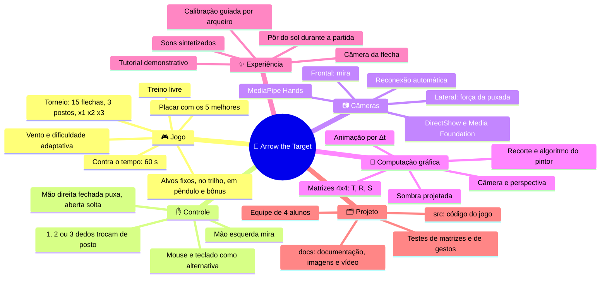

---

## 👥 Equipe

**Disciplina:** Computação Gráfica RA/RV, turma 202602 CC 6A Manhã (Ciência da Computação, 6º semestre, 2026)  
**Professor:** Alex Torquato Souza Carneiro

| | Nome | RA |
|:---:|---|---:|
| 🏹 | Fellipe Augusto Silva Pereira | 2401525 |
| 🏹 | Gabriel Muchon Pavanelli | 2401895 |
| 🏹 | Paloma Eduarda Soares Leite | 2401660 |
| 🏹 | Victor Wenzel Martins Gonçalves | 2401698 |

---

## 🚀 Como rodar

> [!IMPORTANT]
> O MediaPipe com a API `mp.solutions` (usada em `ref/mediapipe`) precisa de **Python 3.12 ou anterior**.

```powershell
py -3.12 -m venv .venv
.venv\Scripts\python -m pip install -r requirements.txt
.venv\Scripts\python src\main.py                          # abre a escolha de câmeras, em tela cheia (janela sem bordas)
.venv\Scripts\python src\main.py --sem-camera --janela    # mouse/teclado, em janela
.venv\Scripts\python src\main.py --mudo                   # sem sons
.venv\Scripts\python src\teste_mat3d.py                   # testes das transformações
.venv\Scripts\python src\teste_entrada.py                 # testes do gesto (mãos sintéticas)
```

Ao abrir, a tela **Escolha das câmeras** lista as câmeras do Windows pelo nome, com uma prévia ao vivo de cada uma, e você marca qual é a frontal e qual é a lateral. A escolha fica salva em `src/config.json` e a tela é pulada nas próximas vezes; `Tab` no menu volta para ela. Câmeras virtuais (DroidCam, OBS) só têm sinal com o aplicativo delas transmitindo; "Procurar de novo" atualiza a lista.

> [!TIP]
> Sem webcam ou sem MediaPipe, o jogo continua funcionando só com mouse e teclado. Se uma câmera cair ou for desconectada, o jogo tenta reconectar sozinho.

A tela cheia é uma **janela sem bordas do tamanho do monitor**: não troca o modo de vídeo, então `Alt+Tab` é instantâneo. O jogo desenha em 1280×720 e amplia mantendo a proporção; em monitores que não são 16:9 aparecem faixas pretas. `F11` alterna com a janela normal.

---

## 🎮 Como jogar

Na **primeira vez**, depois da escolha de câmeras, o jogo mostra um **tutorial demonstrativo** (\~40 s, só para assistir). Nele, o arqueiro se joga sozinho enquanto duas "câmeras de demonstração" mostram mãos fazendo exatamente o gesto de cada etapa: mirar, puxar, soltar, trocar de posto pelos dedos, atirar de longe e acertar o bônus. Logo depois vem a **calibração** das suas mãos. O tutorial pode ser revisto no menu ("Como jogar", tecla `T`) e pulado com Enter.

| 🎯 Mirar com a mão esquerda | 🏹 Puxar a corda com a mão direita |
|:---:|:---:|
| 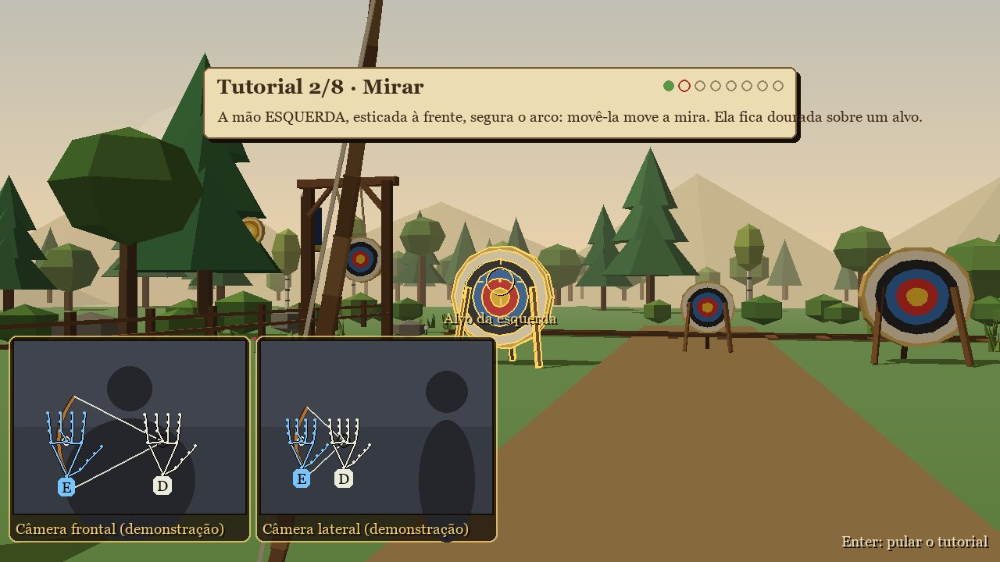 | 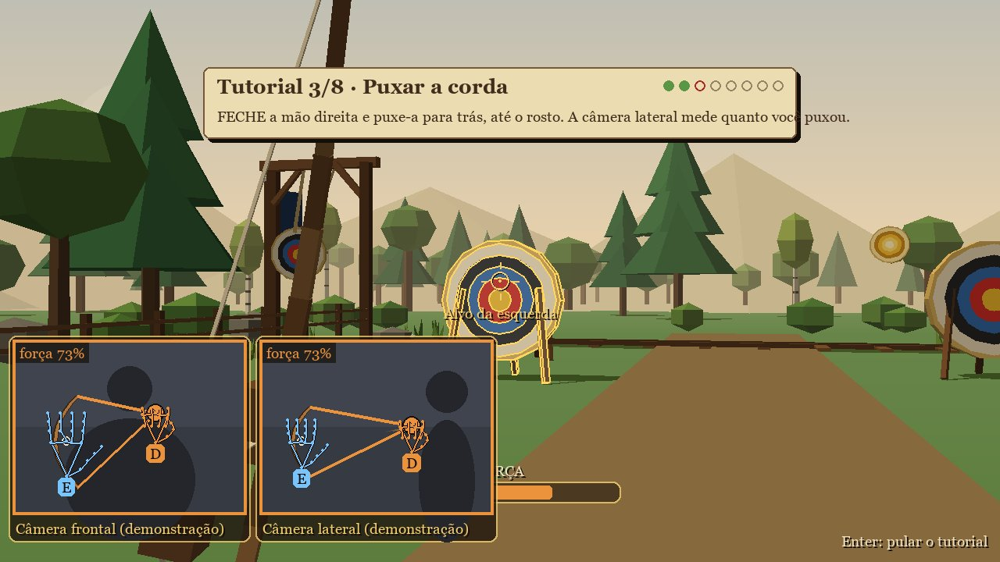 |
| **✌️ Trocar de posto mostrando dedos** | **⭐ Acertar o alvo bônus** |
| 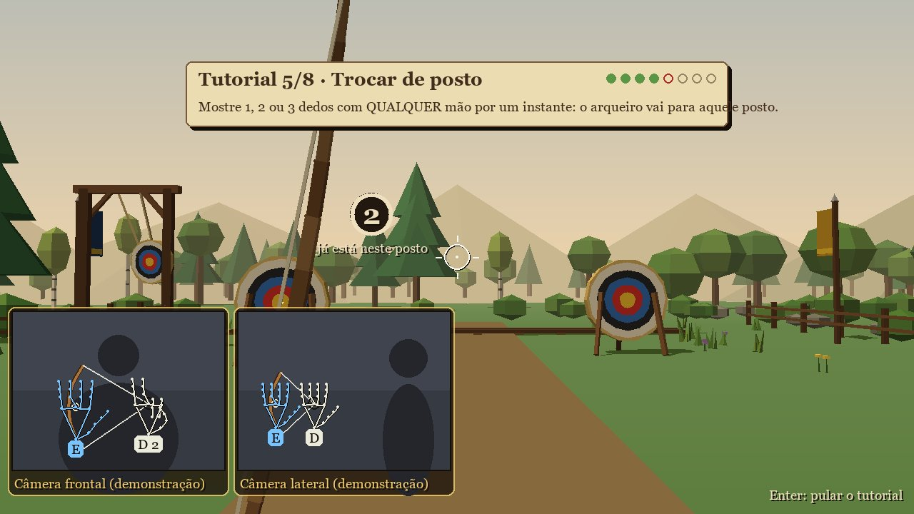 | 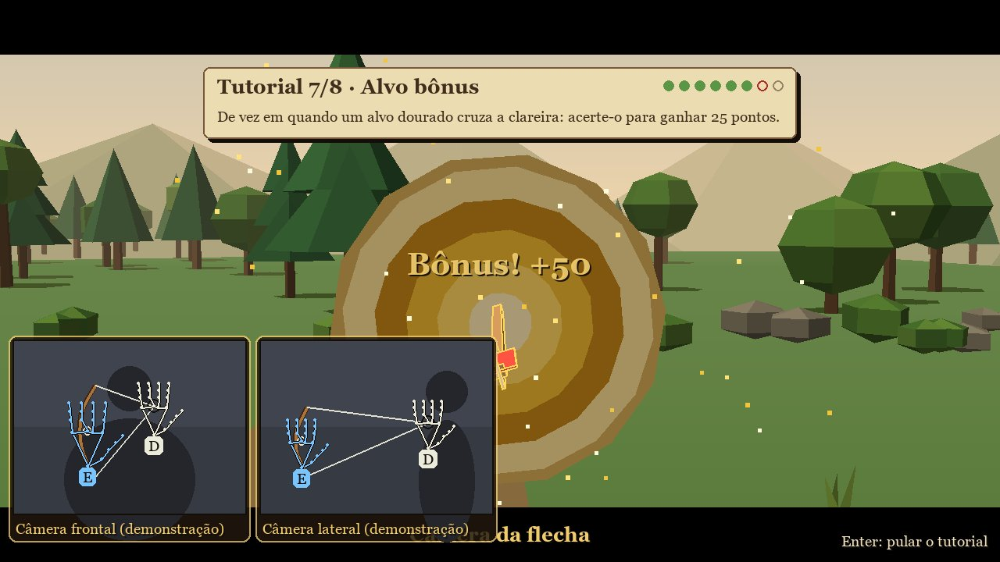 |

No menu você digita o nome do arqueiro (clique na caixa ou `N`), escolhe o modo (setas ou clique) e joga (Enter, clique ou fechando a mão direita).

<div align="center">
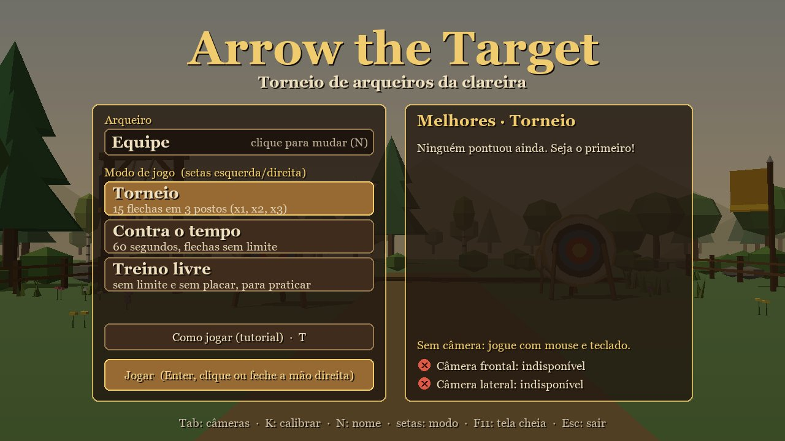
</div>

<br />

| Modo | Regras | Placar |
|---|---|:---:|
| 🏆 Torneio | 15 flechas em 3 postos (15, 25 e 40 m), multiplicadores **x1, x2 e x3** | ✅ |
| ⏱️ Contra o tempo | 60 segundos, flechas sem limite | ✅ |
| 🎯 Treino livre | sem limite de flechas nem de tempo | ❌ |

Os anéis valem 10, 8, 6, 4 e 2 pontos, de dentro para fora. Há 4 alvos fixos ou em movimento: dois fixos, um que corre num trilho e um pendurado que balança. De tempos em tempos aparece um **alvo bônus dourado** cruzando a clareira, que vale 25 pontos (vezes o multiplicador do posto).

Durante a partida, o placar fica no canto superior esquerdo, com as flechas restantes (Torneio) ou o relógio (Contra o tempo) logo abaixo; no Treino livre esse segundo painel não aparece. O vento fica no centro, as câmeras no canto superior direito, e a ajuda e o fps no canto inferior direito.

O vento muda a cada flecha e empurra o voo para o lado; as bandeiras mostram a direção dele. A **dificuldade é adaptativa**: acertando muito, o vento fica mais forte e os alvos móveis mais rápidos; errando, alivia (o painel do vento mostra "Dificuldade 1,2x"). A partida começa à tarde e termina no pôr do sol. Os 5 melhores de cada modo ficam no placar, com nome (`src/placar.json`).

| 🌅 No posto 3 (40 m, x3), já no pôr do sol | 🏁 Fim do torneio |
|:---:|:---:|
| 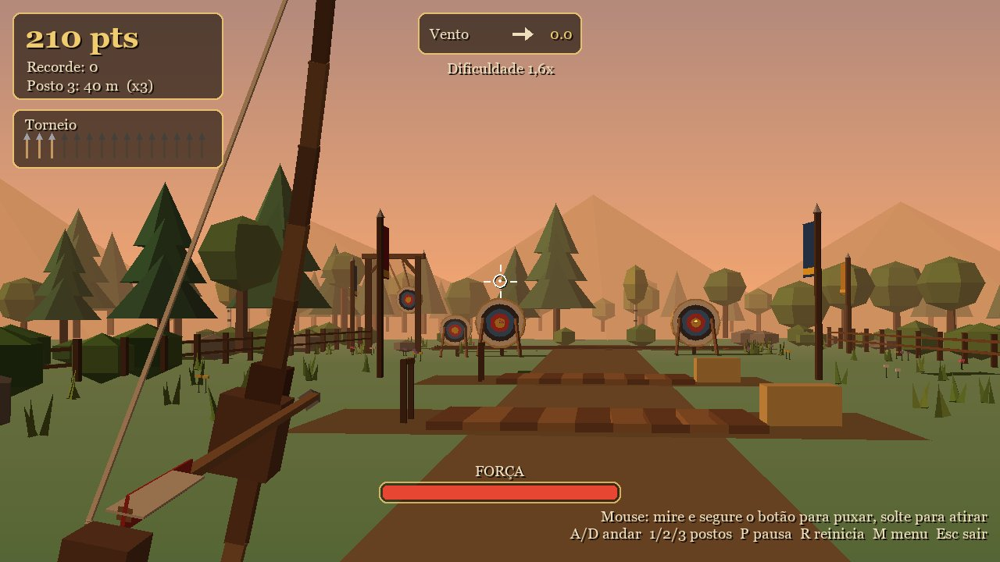 | 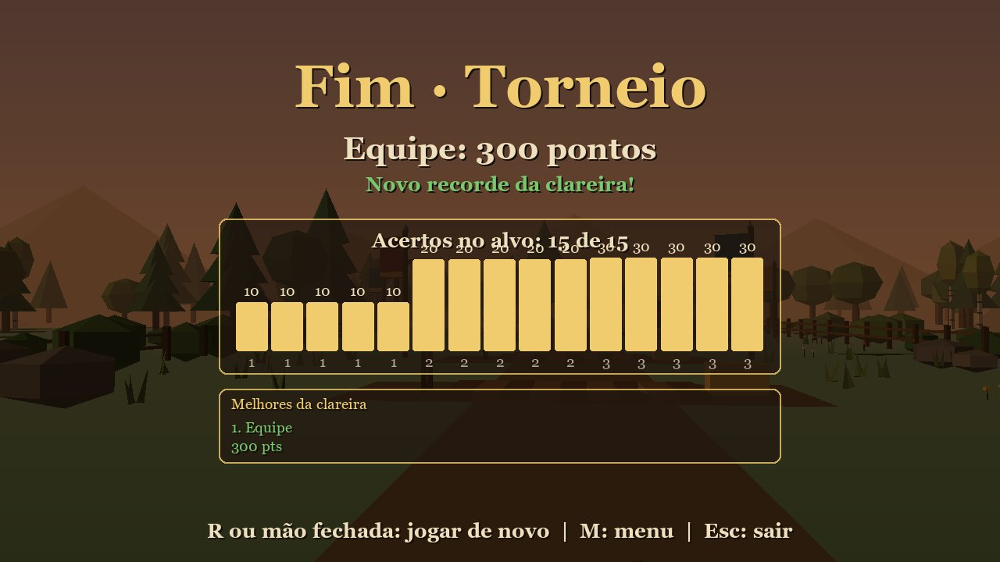 |

Em tiros bons (8, 10 ou bônus), a **câmera da flecha** acompanha o voo em câmera lenta até o alvo (`Espaço` ou clique pulam). O jogo sabe antes porque simula a trajetória no momento do disparo.

<div align="center">
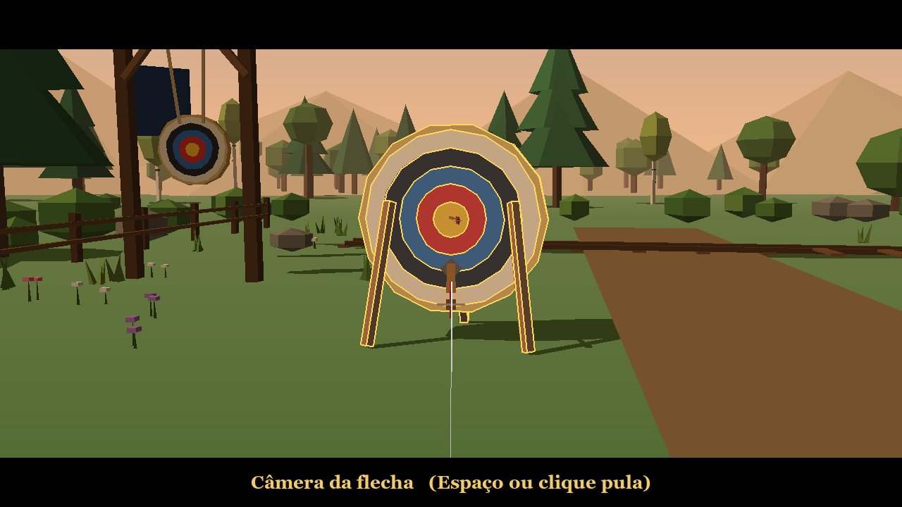
</div>

### 🏹 Gesto do arco (duas câmeras)

Use duas webcams: a **frontal** fica de frente para você e a **lateral** fica de lado, vendo o seu perfil.

- **🫲 Mão esquerda (à frente)** segura o arco. A posição dela na câmera frontal é a mira.
- **✊ Mão direita (atrás)** segura a corda. Feche a mão (punho ou pinça) para encaixar a flecha.
- **💪 Força**: é a distância entre as duas mãos, medida pela câmera lateral. De lado, essa distância aparece bem, mesmo quando você puxa em direção ao rosto. Sem a lateral, a frontal mede a força.
- **🖐️ Atirar**: abra a mão direita. Com força baixa demais, a puxada é cancelada.
- **☝️ Trocar de posto**: mostre **1, 2 ou 3 dedos com qualquer mão** (indicador, indicador + médio, indicador + médio + anelar) por \~1 s. Um anel perto da mira mostra o progresso. Posto mais longe vale mais. Mostrar dedos com a mão da corda não é confundido com segurar a corda.
- **📷 Nas câmeras** (prévias pequenas no canto superior direito; `C` esconde):
  - as prévias desenham o esqueleto de cada mão (azul = arco, cor da força = corda, com etiquetas E e D);
  - também mostram o arco, a corda e o rastro do movimento, na cor da força (verde, amarelo, vermelho);
  - crescem enquanto você puxa;
  - abaixo de cada uma, uma faixa de status mostra o estado ("E: mira · D: 73%"), o fps e avisos como "pouca luz", "mão saindo do quadro" ou "mostre as duas mãos".
- **🪵 Painel "Seu arco"** (`G`): ícones grandes das duas mãos e o que cada uma está fazendo.
- **🧠 Reconhecimento**:
  - o tremor das mãos é suavizado (filtro One Euro);
  - com pouca luz, a imagem é realçada (CLAHE) antes da detecção;
  - o modelo mais preciso do MediaPipe é usado quando a máquina aguenta;
  - se a mão da corda some por um instante (até 0,25 s), a puxada não é cancelada.
- **🔊 Som**: a corda range e estala conforme estica, e os impactos soam à esquerda ou à direita conforme onde caíram.

### 🎯 Calibração guiada

A calibração é guiada, com um pergaminho ilustrando a pose de cada etapa, uma contagem regressiva para você se posicionar e uma lista que fica verde quando as câmeras veem o que precisam:

1. **Mão esquerda**: levante só a mão esquerda, aberta, à frente do corpo, com a direita abaixada. O jogo grava como cada câmera enxerga a sua mão esquerda.
2. **Mão direita**: abaixe a esquerda e levante só a direita, aberta, perto do rosto. Se a câmera frontal confundir com a esquerda, o jogo avisa e espera.
3. **Arco em repouso**: braço esquerdo esticado, mão direita fechada encostada na esquerda.
4. **Puxada completa**: mão direita fechada junto ao rosto. Se a puxada for curta demais, a etapa é repetida.
5. **Tiro de teste**: puxe e solte uma flecha para ver a força alcançada. Polegar para cima (ou Enter) começa o torneio; polegar para baixo (ou `K`) refaz.

Cada etapa só conta enquanto você está parado na pose, e os valores usam a mediana das amostras. Com isso o jogo aprende o centro da mira, quanto da puxada vale força 100% e qual mão é a da corda na imagem lateral. Os papéis das mãos vêm da lateralidade detectada pelo MediaPipe, ligada à sua mão real nas etapas 1 e 2. `L` inverte os papéis (canhoto) e `V` troca qual câmera é a frontal e qual é a lateral.

> [!NOTE]
> A calibração fica **salva por arqueiro** (pelo nome do menu): na próxima vez, quem já calibrou vai direto para o jogo. `K` refaz. Girar a mão do arco inclina o arco na tela, e a força passa por um filtro de Kalman para não tremer.

### ⌨️ Teclado e mouse

| Entrada | Ação |
|---|---|
| 🖱️ Mouse | mira; segurar o botão puxa, soltar atira |
| `Espaço` | puxar/atirar, alternativa ao botão do mouse |
| `A`/`D` ou setas | andar pela plataforma (navegação contínua) |
| `1` `2` `3` | teletransporte entre os postos (ou 1, 2 ou 3 dedos de qualquer mão) |
| `T` / `G` | rever o tutorial (menu) / painel "Seu arco" |
| `Espaço` / clique | pula a câmera da flecha |
| `P` / `R` / `M` | pausa / reinicia / volta ao menu |
| `N`, setas | no menu: editar o nome / trocar o modo |
| `C` | mostra ou esconde as câmeras |
| `Tab` | escolher câmeras (no menu, pausa ou resultado) |
| `V` | troca câmera frontal e lateral |
| `F11` | alterna tela cheia (janela sem bordas do tamanho do monitor) e janela normal; abre em tela cheia, `--janela` para começar em janela |
| `L` / `K` | modo canhoto / recalibrar gesto |
| `Esc` | sair |

---

## 📷 Câmeras: detecção e problemas comuns

A busca (`listar_fontes` em `gestos.py`) junta duas fontes do Windows:

- **DirectShow**, que fornece os nomes dos dispositivos (via `pygrabber`). Cada câmera é aberta já pedindo a resolução: 640×480, depois 1280×720, depois a padrão. Algumas câmeras virtuais, como a *DroidCam Source 3*, só abrem quando a resolução é pedida na abertura.
- **Media Foundation**, que enxerga câmeras virtuais que o DirectShow não abre, como a *DroidCam Video* do app novo da DroidCam. Câmeras repetidas (a mesma imagem nos dois sistemas) são descartadas.

Cada cartão da tela de escolha mostra um destes estados:

| Estado | Significado | O que fazer |
|---|---|---|
| 🟢 Com sinal | a câmera está transmitindo | marque como Frontal ou Lateral |
| 🟡 Conectada, sem transmissão | o dispositivo abre, mas mostra a tela de espera da câmera virtual (tela azul da DroidCam ou "Start DroidCam") | inicie a transmissão no celular; o cartão muda sozinho |
| 🔴 Não abre | o dispositivo existe, mas não entrega imagem (ex.: OBS fechado) | abra o aplicativo da câmera e clique em "Procurar de novo" |

Para usar **duas DroidCams**, cada celular precisa estar transmitindo numa fonte diferente (por exemplo *DroidCam Source 2* e *DroidCam Source 3*, ou uma delas e a *DroidCam Video*). Se uma câmera cair durante o jogo, o rastreador reconecta sozinho.

<details>
<summary><b>🔌 Webcam USB que conecta e cai</b></summary>

<br />

> [!WARNING]
> Se uma webcam aparece e some (na prévia: "Sem sinal" ou "Desconectada, reconectando..."; no Gerenciador de Dispositivos: "Dispositivo USB Desconhecido (Falha na Solicitação de Descritor de Dispositivo)"), o problema costuma ser físico — energia ou banda da porta USB — e não o jogo.

1. ligue a câmera direto numa porta do PC (de preferência na traseira), sem hub nem extensão;
2. deixe as duas webcams em lados diferentes do PC, para não dividirem a mesma porta/controlador;
3. desative a suspensão seletiva USB (Opções de Energia → Alterar configurações do plano → Configurações avançadas → USB → Suspensão seletiva → Desabilitada);
4. se continuar caindo, teste a câmera em outro computador: se lá também cair, o defeito é do cabo ou da câmera.

Depois de reconectar, `Tab` no menu e "Procurar de novo" atualizam a lista. Para ver se o Windows está enxergando as câmeras, no PowerShell: `Get-PnpDevice -Class Camera,Image -PresentOnly`.

</details>

---

## ⚡ Desempenho

A cena é desenhada em software (numpy + `pygame.draw.polygon`), então o fps depende da CPU. O laço vai até 120 fps (`FPS_MAXIMO` em `main.py`) e o fps aparece no canto inferior direito.

| Situação (medida num i7-3770) | fps |
|---|:---:|
| 🖱️ Sem câmeras (`--sem-camera`) | \~60 |
| 📷 Com as duas câmeras e o MediaPipe | \~40 |

Com as câmeras, as duas instâncias do MediaPipe (\~30–40 ms por detecção cada) disputam a CPU com o desenho; numa CPU mais nova a diferença deve ser menor (não medido). As otimizações do renderizador estão descritas na [documentação técnica](docs/DOCUMENTACAO.md).

---

## ✅ Requisitos do enunciado

| Requisito | Onde |
|---|---|
| 🎯 Tema e tarefa | Arrow the target, com competição: 3 modos e placar com nomes |
| 🕹️ Entradas | Teclado, mouse e câmera com OpenCV + MediaPipe (`gestos.py`, `entrada.py`) |
| 🌲 Objetos do cenário / selecionáveis | Floresta (pinheiros, árvores de copa, bétulas, arbustos, grama, flores), cercas, postos e estandartes / 4 alvos + alvo bônus (`cena.py`, `modelos.py`) |
| 🧮 Transformações | Matrizes T·R·S em coordenadas homogêneas, câmera (visão + perspectiva), recorte, sombra planar projetada (`mat3d.py`, `render.py`) |
| 🎞️ Animação | Por Δt: alvo no trilho com ease-in-out, pêndulo hierárquico T(pivô)·R(θ), alvo bônus em percurso, flechas cravadas que seguem o alvo, estandartes ao vento, teletransporte interpolado, ciclo de luz da tarde ao pôr do sol |
| 🧭 Navegação | Contínua (`A`/`D`, mira) e por teletransporte (`1`/`2`/`3` ou contando dedos na câmera) |
| 👆 Seleção | Linha de visada destaca o alvo em foco; disparo por gesto, clique ou tecla |
| 💬 Feedback | Arco 3D em primeira pessoa que verga com a puxada, puxada desenhada nas câmeras na cor da força, contorno dourado no alvo em foco, barra de força e zoom, rangido da corda, som posicional, câmera da flecha, partículas no impacto, rastro da flecha, pontuação flutuante, flechas cravadas e o último acerto destacado (pistas de ações passadas) |

---

## 🗂️ Estrutura

```text
docs/
  enunciado_AP2.pdf          enunciado da avaliação
  DOCUMENTACAO.md            documentação técnica do projeto
  imagens/                   capturas do jogo e fotos do vídeo usadas neste README
  video/                     vídeo de apresentação do jogo
src/
  main.py                    laço do jogo e máquina de estados
  mat3d.py                   matrizes 4x4, câmera, projeção, interpolação
  modelos.py                 malhas low-poly procedurais
  render.py                  pipeline de renderização em software (pintor)
  cena.py                    clareira, alvos animados e estandartes
  flecha.py                  balística e colisões
  gestos.py                  câmeras (listagem) e thread OpenCV + MediaPipe Hands
  telas.py                   menu, escolha de câmeras e calibração guiada (ilustração)
  entrada.py                 gesto/mouse/teclado -> comando do arco (filtro de Kalman)
  hud.py                     interface e telas
  sons.py                    efeitos sonoros sintetizados com numpy
  tutorial.py                tutorial demonstrativo (o jogo se joga sozinho)
  particulas.py              partículas de palha, terra e madeira
  teste_mat3d.py             testes das transformações
  teste_entrada.py           testes do gesto com mãos sintéticas
ref/                         material de referência da disciplina
  aulas/                     slides das aulas 01 a 12
  exercicios/                enunciados de exercícios por aula
    pygame_aulas_1_a_9/      exercícios pygame + modelos .obj
  mediapipe/                 guia e exercícios do MediaPipe
  notebooks/                 notebooks Jupyter das aulas
```

<br />

<div align="center">

**🏹 Arrow the Target** · AP2 de Computação Gráfica RA/RV · 2026.2

<sub>Feito com pygame, NumPy, OpenCV e MediaPipe. Todo o 3D (posição, rotação, escala, câmera e perspectiva) é calculado com matrizes 4×4 do NumPy, sem OpenGL.</sub>

<br />

<a href="#readme"></a>


</div>
